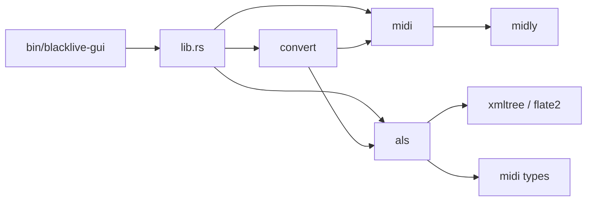

# 模块边界与文件地图

Blacklive 现在是一个小的 Rust workspace 式项目：一个 library crate（`src/lib.rs`）加一个 GUI binary（`src/bin/blacklive-gui/`）。核心转换逻辑都在 library 里，GUI 只做壳和文件选择。

## 模块职责

| 模块 | 职责 | 不应该做的事 |
|---|---|---|
| `src/lib.rs` | 公共 API 门面、内置模板常量、`format_num` | 不做 MIDI 解析、不直接改 XML |
| `src/midi/` | 读 MIDI、音符配对、Tempo/拍号、CC/PB/RPN 统计 | 不知道 Ableton、不写 `.als` |
| `src/convert/` | 过滤/移调、按通道/源轨分组、调用 `als` 注入、组装结果 | 不直接拼 XML 节点、不处理 UI |
| `src/als/` | `.als` gzip/XML、模板检查、Group 克隆、ID 重映射、Clip/PB/Tempo 注入 | 不读 MIDI 文件、不做 GUI |
| `src/bin/blacklive-gui/` | egui 界面、文件选择、状态/日志、调用 library | 不复制转换逻辑 |
| `assets/default.als` | 内置 A01 路由模板 | 不在运行时修改 |

## 依赖方向



`midi` 是最底层，不依赖 `als` 或 `convert`。  
`convert` 同时依赖 `midi` 和 `als`，是编排层。  
`als` 依赖 `midi` 的事件类型，但不读 MIDI 文件。  
GUI 只依赖 library 的公共 API。

## 公共 API 边界

`src/lib.rs` 公开导出：

- `als::{ClipInfo, ClipLocation, TemplateReport, TrackInfo, TrackKind}`
- `convert::{ConversionResult, ConvertOptions, GroupResult, TrackResult, convert_midi_to_als, convert_midi_to_als_with_default_template, inspect_template, parse_channel_filter}`
- `midi::{ControllerEvent, MidiStats, Note, ParsedMidi, parse_midi_file}`
- `DEFAULT_TEMPLATE_LABEL`、`DEFAULT_TEMPLATE_BYTES`
- `inspect_default_template`、`dump_default_template_xml`、`format_num`

`als` 内部大量使用 `pub(crate)`，例如：

- `inject_groups`
- `enumerate_clips` / `select_clip`
- `PointeeAllocator` / `remap_pointee_ids`
- `validate_live_set`
- XML helper（`attr`、`ensure_child`、`find_descendant` 等）

这些不是稳定外部 API，重构时可以调整。

## 文件地图

```text
src/
├── lib.rs                       # 公共门面
├── midi/
│   ├── mod.rs                   # 导出 parse/types
│   ├── types.rs                 # Note、事件、MidiStats
│   └── parse.rs                 # SMF 解析、RPN、Tempo、音符配对
├── convert/
│   ├── mod.rs                   # 导出公共 API
│   ├── options.rs               # ConvertOptions
│   ├── results.rs               # ConversionResult / GroupResult / TrackResult
│   ├── pipeline.rs              # 转换编排
│   ├── grouping.rs              # 通道/源轨分组、空轨
│   ├── filter.rs                # 过滤、移调、重叠截短
│   └── channels.rs              # 通道过滤字符串
├── als/
│   ├── mod.rs                   # 公共类型 + 内部重导出
│   ├── io.rs                    # gzip/XML 读写
│   ├── inspect.rs               # 模板报告、Clip 枚举
│   ├── validate.rs              # ID 校验
│   ├── pointee.rs               # ID 分配/重映射
│   ├── inject/
│   │   ├── mod.rs               # inject_groups 编排
│   │   └── clone.rs             # 单轨/路由模式克隆
│   ├── clip.rs                  # Clip、音符、PB/CC 包络
│   ├── tempo.rs                 # Tempo 自动化
│   ├── devices.rs               # 设备/效果/PB Range
│   └── xml.rs                   # XML 小工具
└── bin/blacklive-gui/
    ├── main.rs                  # eframe 启动
    ├── app.rs                   # App 状态、转换调用、主 UI
    ├── files.rs                 # 文件选择、模板分析、拖拽
    ├── options.rs               # 高级选项
    ├── stats.rs                 # MIDI 统计显示
    ├── status.rs                # 状态/日志
    └── actions.rs               # FileActions/ActionFlags、打开文件
```

`Cargo.toml` 使用 `autobins = false` 和显式 `[[bin]]`，因为 GUI 的入口在 `src/bin/blacklive-gui/main.rs`。

## 建议阅读顺序

1. `src/lib.rs`：先看对外 API 和默认模板
2. `src/convert/pipeline.rs`：看一次完整转换的编排
3. `src/convert/grouping.rs`：看通道/源轨/空轨如何变成 GroupPlan
4. `src/als/inject/mod.rs` 与 `clone.rs`：看模板如何被克隆和写入
5. `src/als/clip.rs`：看音符、PB/CC、ClipEnvelope
6. `src/midi/parse.rs`：最后再看 MIDI 解析细节
7. `src/bin/blacklive-gui/`：如果要做 UI 改动

## 相关阅读

- [项目总览](../overview.md)
- [构建、测试与 Live 验证](../operations/build-test.md)
- [转换流水线](pipeline.md)
