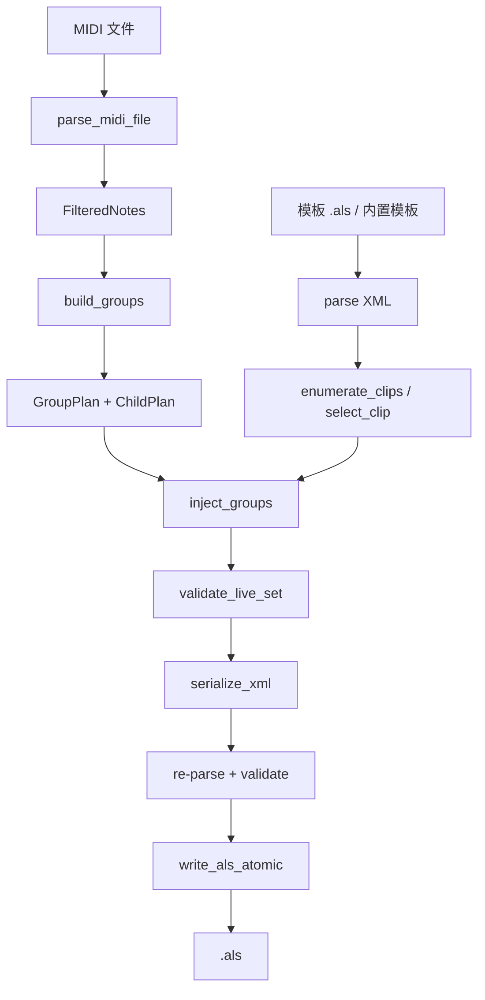

# 转换流水线

入口在 `src/convert/pipeline.rs` 的 `convert_midi_to_als` / `convert_midi_to_als_with_default_template`。两者只差模板来源：文件路径或内置 `assets/default.als`。

## 端到端流程



## 阶段 1：路径与模板

- 先检查输出不能覆盖输入 MIDI 或模板 `.als`
- `TemplateSource::load` 读模板：
  - 文件模板：`read_als_xml`
  - 内置模板：`read_als_bytes(DEFAULT_TEMPLATE_BYTES)`
- XML 解析后枚举所有 `MidiClip`
- `select_clip` 按优先级选择原型 Clip：
  1. 显式 `template_clip_index`
  2. `template_clip_name`
  3. Group 内的 Arrangement Clip
  4. 任意 Group 内 Clip
  5. 第一个 Arrangement Clip
  6. 第一个 Clip

如果模板没有 Clip，或索引/名称不匹配，会直接报错。

## 阶段 2：MIDI 解析与过滤

`parse_midi_file` 产出 `ParsedMidi { notes, stats }`。随后：

- 通道过滤：默认排除 GM 鼓通道（0-based index 9）
- 移调：超出 MIDI 0–127 的音符丢弃
- 最短时值：小于 `min_note_beats` 的音符被拉长
- 同音高重叠：可选截短前音
- 过滤后没有音符：报错

这些统计会进入 `FilteredNotes`，并在最终 `ConversionResult` 中报告丢弃/截短数量。

## 阶段 3：BPM、起点、Tempo Map

BPM 优先级：

```text
bpm_override
  > MIDI 初始 BPM
  > 模板 BPM
  > 120
```

Arrangement 起点默认 0，负数会 warning 并改为 0。Tempo Map 的每个 tick 会加上起点偏移；如果只有 1 个有效点，就只写固定 BPM，不创建 Tempo 自动化。

## 阶段 4：分组

`build_groups` 做三件事：

1. 按 `channel` 分组
2. 如果 `split_source_tracks` 为真，再按 `source_track` 分组；否则所有源轨合并到 0
3. 每个 channel 生成 `A01`、`A02`……

每个子轨会得到：

- `source_track`
- `track_name`（优先用 MIDI Track Name，空名用 `A01-01`）
- `clip_name`
- 音符
- `clip_length_beats = max(note.start + duration) + tail`

原型选择：如果模板里有同名 `A01`/`A02` Group，就用它；否则用当前选中的默认 Clip。

保留空轨时，会检查 `track_channels`：某个源轨在某个 channel 有 MIDI 事件但没有音符，就补一条 `notes = []` 的子轨。

## 阶段 5：注入模板

`inject_groups` 接收 `GroupInjectRequest`，负责：

- 写 Tempo（固定 BPM + 可选自动化）
- 初始化 `PointeeAllocator` 和 `next_track_id`
- 逐个 Group：
  - 解析原型 Group
  - 克隆 GroupTrack 并重映射 Pointee ID
  - 单轨模式或路由模式克隆子轨
  - 写 Clip、音符、PB/CC
  - 空轨只保留轨道
- 删除原型 Group 及其子轨，插入新 Group/子轨
- 推进 `NextPointeeId`

路由模式的详细结构见 [Live 模板与 ID 体系](template-and-ids.md)。

## 阶段 6：校验与写出

写出前做两次校验：

1. 注入后 `validate_live_set(&root)`
2. 序列化后重新 `parse_xml`，再 `validate_live_set(&reparsed)`

然后 `write_als_atomic`：

- gzip 压缩
- 写入同目录临时文件
- `rename` 到目标 `.als`

任一步失败都不会留下半成品输出。

## 主要失败点

- 输出路径覆盖输入/模板
- 模板没有 `<LiveSet>`、`<Tracks>`、`<MainTrack>` 等节点
- 模板没有可用 Clip
- MIDI 没有可写音符
- 过滤后 groups 为空
- 原型 Group 子轨数量不符合单轨/路由模式
- Clip 写入后 `MidiNoteEvent` 数量不一致
- Pointee ID 重复或超过 `NextPointeeId`

## 相关阅读

- [Clip、音符与自动化](clip-and-automation.md)
- [Live 模板与 ID 体系](template-and-ids.md)
- [项目总览](../overview.md)
